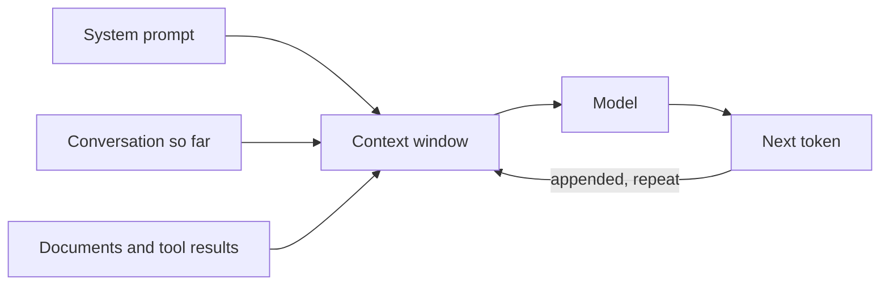

# 1. How LLMs work (enough to engineer with)

## After this chapter you will be able to

- Explain tokens, context windows and sampling well enough to make design decisions.
- Predict the common failure modes before you hit them.
- Estimate the cost and latency of a call.

## The one-paragraph model

A language model takes a sequence of tokens and predicts the next one, over and over,
until it decides to stop or hits a limit. Everything else, including chat, tool use,
JSON output and "reasoning", is built on that loop. The model has no memory between
calls. Whatever it should know for this request has to be in this request.



## Tokens

Models read and write tokens, which are chunks of text. In English a token averages
about three quarters of a word. Code, non-English text and unusual strings (IDs, hashes,
base64) use more tokens per character.

Why you care:

- **Billing** is per token, with output usually priced several times higher than input.
- **Limits** (context size, max output) are in tokens.
- **Latency** is dominated by output tokens, because they are generated one at a time.
  Input is read in parallel and is comparatively fast.

A rough mental formula:

```
latency ≈ time_to_first_token + output_tokens / tokens_per_second
cost    ≈ input_tokens × input_price + output_tokens × output_price
```

So the cheapest way to make a feature faster is often to ask for less output.

## The context window

The context window is everything the model can see for one call: system prompt,
conversation history, documents, tool definitions, tool results, and the output it is
writing. It has a hard size limit that varies by model.

Two properties matter more than the limit itself:

1. **Statelessness.** A "conversation" is your application re-sending the history every
   turn. If you do not send it, the model does not have it.
2. **Attention is not uniform.** A model with a large window can still lose track of a
   detail buried in the middle of a very long context. More context is not free: it
   costs money, time, and sometimes accuracy.

The practical rule: give the model everything relevant and nothing that is not.

## Sampling

At each step the model produces a probability for every possible next token, and one is
sampled. Settings shape that choice:

| Setting | Effect | Typical use |
|---|---|---|
| `temperature` | Lower = more predictable, higher = more varied | Low for extraction and classification, higher for brainstorming |
| `top_p` / `top_k` | Cut off the unlikely tail | Usually leave at default |
| `max_tokens` | Hard cap on output length | Always set deliberately |
| stop sequences | End generation at a marker | Parsing, bounded outputs |

Temperature zero reduces variation but does not guarantee identical output across calls.
Design for variation rather than assuming it away.

> **Provider notes**
> Some newer models, especially ones with built-in reasoning, restrict or ignore
> sampling parameters. Check before you build a design that depends on a specific
> temperature.

## Reasoning modes

Many current models can spend tokens thinking before they answer (called "extended
thinking", "reasoning" or similar). This helps on multi-step problems, planning and
hard debugging. It costs more and takes longer. Use it where the task needs it, and
turn it down for simple, high-volume calls.

## What the model does and does not know

- **Training data** has a cutoff date. The model does not know what happened after it,
  and may not know which date it is unless you say.
- **Your data** (codebase, docs, customers) is unknown unless it is in the context.
- **Itself.** A model's description of its own abilities or internals is a guess. Test
  rather than ask.

## Failure modes to expect

| Failure | What it looks like | Usual fix |
|---|---|---|
| Hallucination | Confident, plausible, wrong (a function that does not exist, a made-up citation) | Supply the source material; ask for quotes; allow "I don't know" |
| Instruction drift | Rules followed early, forgotten in a long conversation | Shorter context; restate key rules; move them to the system prompt |
| Over-compliance | Does what was literally asked, not what was meant | Explain the goal, not just the task |
| Format wobble | Valid JSON 99% of the time | Structured output features and validation (chapter 4) |
| Truncation | Output stops mid-sentence | Check the stop reason; raise `max_tokens` or ask for less |
| Sycophancy | Agrees with a wrong premise in the question | Ask neutrally; ask for the strongest counter-argument |

None of these are exotic. All of them should be in your test set.

## Choosing a model

Providers offer tiers: a large, most capable model; a mid-size workhorse; and a small,
fast, cheap one. A workable default:

1. Prototype with the most capable model so you learn whether the task is possible.
2. Once it works and you have evals, try the smaller tiers and see what breaks.
3. Use the smallest model that passes your evals, and route the hard cases upward.

Choosing a small model first often produces a wrong conclusion: "the model can't do
this", when a better model could.

## Common mistakes

- Treating the model as a database of facts instead of a reasoner over supplied text.
- Assuming the model remembers earlier calls.
- Leaving `max_tokens` at a default and discovering truncation in production.
- Stuffing the context "to be safe" and paying for it in cost, latency and accuracy.
- Concluding a task is impossible after testing only a small model with a weak prompt.

## Exercises

1. Take a paragraph of English, a block of code and a UUID. Count tokens for each with
   your provider's tokenizer or token-counting endpoint.
   *Good answer: you can state tokens-per-character for each and explain why they differ.*
2. Ask a model about an event after its training cutoff, with and without supplying a
   short article about it.
   *Good answer: you observe guessing or refusal without the article, and grounded answers with it.*
3. Run one prompt at three temperatures, five times each. Describe the differences.
   *Good answer: a concrete statement such as "structure is stable, word choice varies, and at high temperature two of five drifted off topic".*
4. Set `max_tokens` too low on purpose. Find how your SDK tells you the output was cut off.
   *Good answer: you know the field name for the stop reason and what value means truncation.*

---
Previous: [0. How to use this book](00-how-to-use-this-book.md) · Next: [2. Prompting fundamentals](02-prompting-fundamentals.md)
