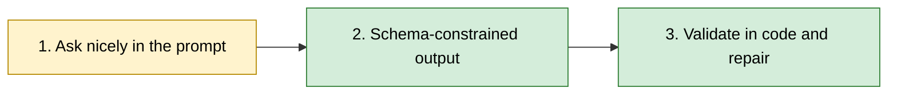

# 4. Structured output

## After this chapter you will be able to

- Get machine-readable output from a model reliably.
- Choose between prompt-only JSON, schema-constrained output and tool calling.
- Design schemas that models fill in well, and handle the cases where they don't.

## Why this is its own chapter

The moment model output feeds code instead of a person, "usually right" stops being
good enough. One malformed response in a thousand is an on-call page at scale.
Structured output is the first production problem most teams meet.

## Three levels of reliability



### Level 1: ask in the prompt

```text
Return only a JSON object with keys "title" (string) and "tags" (array of strings).
No prose before or after.
```

Works most of the time. Fails by adding a preamble ("Here is the JSON:"), wrapping the
object in a code fence, omitting a key, or producing an unescaped quote. Fine for
prototypes; not sufficient alone in production.

### Level 2: schema-constrained output

Most providers let you pass a JSON Schema and guarantee the response conforms to it.
The model's sampling is restricted so that invalid output cannot be produced.

```python
schema = {
    "type": "object",
    "properties": {
        "title": {"type": "string"},
        "tags": {"type": "array", "items": {"type": "string"}},
    },
    "required": ["title", "tags"],
    "additionalProperties": False,
}

response = llm.generate(messages=[...], output_schema=schema)
data = json.loads(response.text)   # will parse
```

This guarantees **shape**, not **truth**. A field that must be a string will be a
string; whether it is the right string is still your problem.

> **Provider notes**
> The feature is called "structured outputs" at Anthropic and OpenAI, and
> "response schema" or "controlled generation" at Google. Each supports a subset of
> JSON Schema, and the subsets differ (limits on recursion, numeric ranges, string
> patterns and so on). Read the supported-features page before designing a complex
> schema. Open-model servers offer the same idea as grammar-constrained decoding.

### Level 3: validate and repair

Parse into a typed model (Pydantic, Zod, or your language's equivalent) and check the
things a schema cannot: cross-field rules, values that must exist in your database,
ranges that depend on context.

```python
def extract(text, attempts=2):
    messages = [user(PROMPT.format(text=text))]
    for _ in range(attempts):
        response = llm.generate(messages=messages, output_schema=SCHEMA)
        try:
            return Invoice.model_validate_json(response.text)
        except ValidationError as err:
            messages += [assistant(response.text),
                         user(f"That failed validation:\n{err}\nReturn a corrected object.")]
    raise ExtractionFailed(text)
```

Feed the validation error back. Models are good at fixing a specific stated problem.
Cap the retries, and decide what the caller does on final failure: a queue for human
review is usually better than a crash or a silent default.

## Tool calling as structured output

Tool calling (also "function calling") is the same mechanism pointed at a different
goal. You describe functions with JSON Schema parameters; the model replies with a
structured request to call one. Chapter 8 covers tools for agents. For extraction, a
single tool that the model is forced to call is another way to get a typed object, and
on some platforms it predates the dedicated structured output feature.

Use dedicated structured output when you want **an answer in a shape**. Use tools when
you want the model to **choose an action**.

## Designing schemas models fill in well

A schema is a prompt. The model reads field names and descriptions to decide what goes
where.

**Name fields for what they mean.**

```text
Weak:   "d1", "d2", "amt"
Better: "invoice_date", "due_date", "total_amount_cents"
```

**Describe every non-obvious field**, including units, format and what to do when the
information is missing.

```json
"due_date": {
  "type": ["string", "null"],
  "description": "Payment due date as YYYY-MM-DD. null if the invoice does not state one. Do not compute it from payment terms."
}
```

**Prefer enums to free text** for anything you will branch on.

**Make absence representable.** If a field is required and non-nullable, the model must
put something there, and when the source has nothing it will invent it. Nullable fields
and an explicit `"unknown"` enum value are how you prevent schema-induced hallucination.

**Put reasoning before conclusions.** Fields are generated in order. A `reasoning`
field placed before `verdict` lets the model think first; placed after, it becomes a
justification of a decision already made.

```json
{ "evidence": "...", "reasoning": "...", "verdict": "approve" }
```

**Keep it flat and small.** Deep nesting and dozens of optional fields raise the error
rate. If a schema is huge, consider several calls.

**Ask for money and time in unambiguous units.** Integer cents, ISO 8601 dates,
explicit time zones.

## Worked example: invoice extraction

**Bad prompt**
```text
Extract the invoice data as JSON.
```

**Why it fails**: No schema, so keys vary between calls. No policy for missing values,
so absent fields get plausible inventions. Amounts arrive as "$1,200.00" in one
response and 1200 in the next.

**Better prompt**
```text
Extract fields from the invoice text below into the provided schema.

Rules:
- Copy values as they appear; do not correct apparent errors in the source.
- Amounts are integer cents in the invoice's currency.
- Use null for anything the invoice does not state.
- line_items must sum to subtotal_cents. If they do not, extract what is written and
  set needs_review to true.

<invoice_text>
...
</invoice_text>
```
with a schema containing `vendor_name`, `invoice_number`, `invoice_date`, `due_date`
(nullable), `currency` (enum), `line_items[]`, `subtotal_cents`, `tax_cents` (nullable),
`total_cents`, and `needs_review` (boolean).

**What changed**: The schema fixes the shape, the rules fix the units and the
missing-data policy, and `needs_review` gives the model an honest way to flag doubt.
Code then re-checks the arithmetic, because that is cheap and certain.

## When not to use structured output

- When a person reads the answer. Forcing prose into JSON makes it worse.
- When you need long free-form text plus a little structure. Ask for the text with
  simple delimiters (`<answer>...</answer>`) and extract with a regex.
- For streaming UIs where partial JSON is awkward, unless your SDK supports partial parsing.

## Common mistakes

- Trusting schema conformance as correctness.
- Required non-nullable fields for information that is sometimes absent.
- Parsing with regex what a schema feature would guarantee.
- Unbounded retry loops.
- Hitting `max_tokens` mid-object: the JSON is cut off and unparseable. Check the stop
  reason before parsing.
- Changing a schema without versioning it, breaking stored data and downstream readers.

## Exercises

1. Write a level-1 prompt for extracting `{name, email, company}` from a signature block
   and run it 50 times on varied inputs. Count failures and classify them.
   *Good answer: a failure rate and a list of failure types, such as fences, preambles and missing keys.*
2. Move the same task to schema-constrained output. Re-run.
   *Good answer: parse failures drop to zero; you can point to remaining errors of truth rather than shape.*
3. Give the extractor an input with no email address, first with `email` required and
   non-nullable, then nullable.
   *Good answer: you observe an invented or placeholder email in the first case and null in the second.*
4. Add a `confidence: "high" | "low"` field and a rule for when to use "low". Check
   whether "low" correlates with actual errors on 30 labeled inputs.
   *Good answer: a two-by-two table, and an honest conclusion about whether the field is useful.*
5. Implement validate-and-repair with a cap of two attempts and a dead-letter list.
   *Good answer: a deliberately impossible input ends up in the list, not in an exception or an endless loop.*

---
Previous: [3. Good vs bad prompts](03-good-vs-bad-prompts.md) · Next: [5. Application architectures](05-application-architectures.md)
