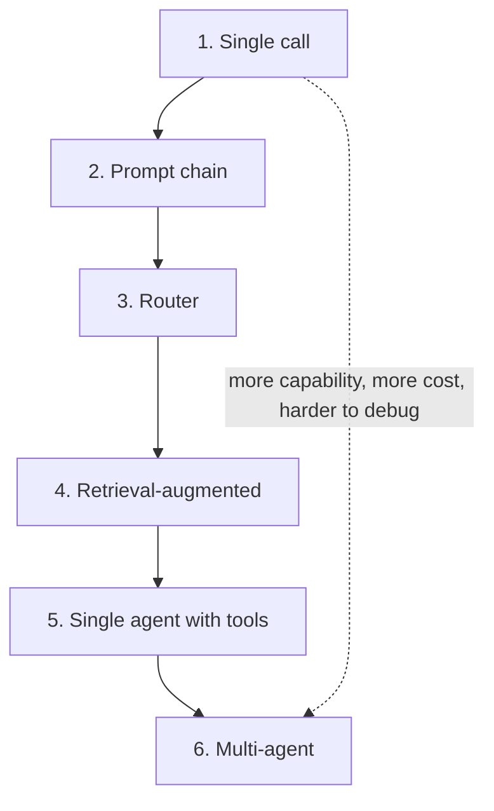
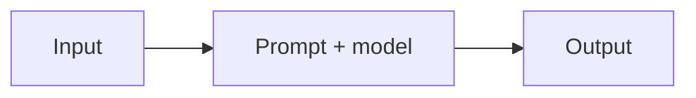
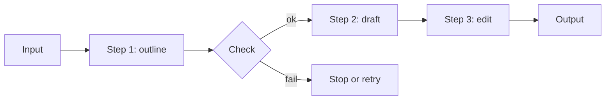
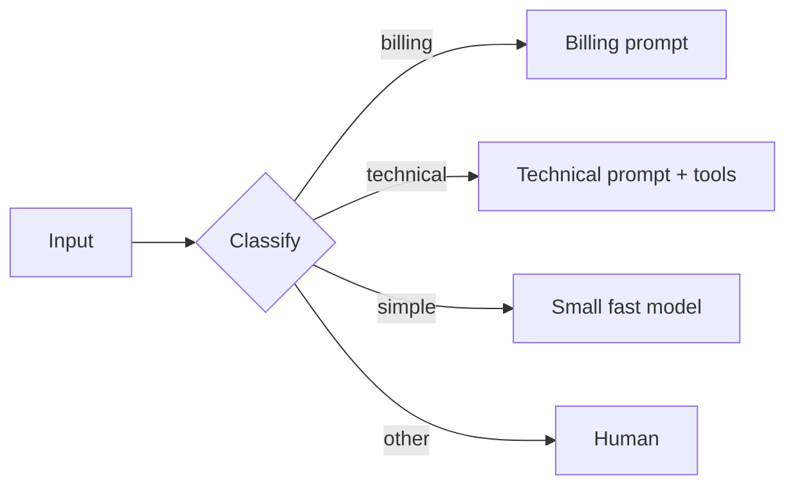
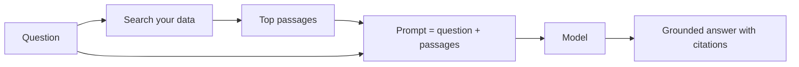
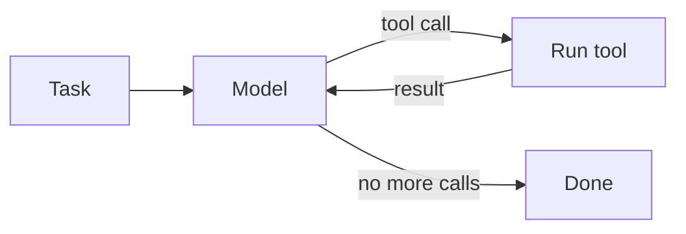
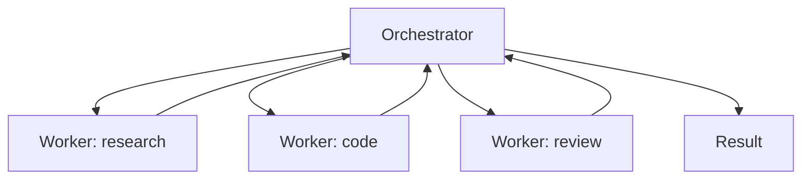
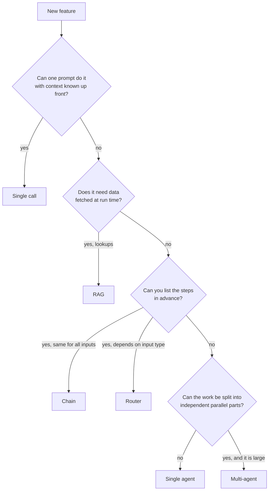

# 5. Application architectures

## After this chapter you will be able to

- Name the common shapes of LLM applications and draw each one.
- Choose the simplest architecture that fits a problem.
- Recognize when an agent is warranted and when it is overkill.

## The ladder

Architectures form a ladder. Each rung adds capability and also adds cost, latency and
ways to fail. Climb only when the rung below demonstrably cannot do the job.



The distinction that matters most is between **workflows** and **agents**:

- In a **workflow**, your code decides the steps. The model fills in each one.
- In an **agent**, the model decides the steps, in a loop, until it judges the task done.

Workflows are predictable and easy to test. Agents are flexible and handle tasks whose
steps you cannot list in advance. Most production features are workflows.

## 1. Single call



One prompt, one response. Classification, extraction, summarization, rewriting,
translation, drafting.

| Use when | Avoid when |
|---|---|
| The task fits in one instruction | It needs information you can only find at run time |
| All needed context is known up front | It needs several distinct kinds of thinking |

A great deal of value ships at this rung. Exhaust it before moving up.

## 2. Prompt chain



A fixed sequence of calls, each consuming the previous output, with code checks
("gates") between them.

| Use when | Avoid when |
|---|---|
| The task splits into clear stages | The stages are not really separable |
| You want to verify intermediate results | Latency budget is one call |
| Different stages suit different models or prompts | |

Variants worth knowing:

- **Parallelization.** Split work into independent pieces, run them at once, merge.
  Example: review a document for accuracy, tone and legal risk with three focused prompts.
- **Voting.** Run the same prompt several times and take the majority, for high-stakes
  classification.
- **Generate then critique.** One call writes; a second, with a fresh context and a
  different prompt, reviews; the first revises. A separate reviewer catches more than
  self-review in the same context.

## 3. Router



A cheap first step classifies the input and dispatches it to a specialized handler.

| Use when | Avoid when |
|---|---|
| Inputs fall into distinct categories needing different handling | Categories overlap heavily |
| You want to send easy cases to a cheaper model | Misrouting is costly and you cannot detect it |

A router can be a model call, a keyword rule, or a traditional classifier. Always
include an "other" route.

## 4. Retrieval-augmented generation (RAG)



Fetch relevant material at run time and put it in the prompt. Chapter 7 covers this in depth.

| Use when | Avoid when |
|---|---|
| Answers depend on your private or fast-changing data | The whole corpus fits comfortably in the context window |
| You need citations | The question needs reasoning over the entire corpus at once |

## 5. Single agent with tools



The model is given tools and a goal, and loops: decide, act, observe, repeat. Chapter 8
covers this in depth.

| Use when | Avoid when |
|---|---|
| The steps cannot be known in advance | You can write the steps down; then it is a workflow |
| The task needs exploration (debugging, research, multi-system operations) | Errors are irreversible and there is no review step |
| You can bound cost and risk | You need tight, predictable latency |

## 6. Multi-agent



One agent delegates to others, each with its own context window and often its own tools.

| Use when | Avoid when |
|---|---|
| Sub-tasks are independent and can run in parallel | Sub-tasks share a lot of state |
| A sub-task would flood the main context with detail | A single agent can do it; coordination is not free |
| You want an independent reviewer | Token cost matters more than wall-clock time |

Multi-agent systems use several times the tokens of a single agent. The handoffs lose
information in both directions. Reach for this last.

## A decision procedure



Real systems combine these: a router whose "technical" branch is an agent whose tools
include a RAG search. Compose from simple parts, and be able to draw the result.

## Worked example: support assistant, three ways

**Requirement.** Answer customer questions about an invoicing product; look up account
state; hand off refunds to a human.

**Version A: single call with the help center in the prompt.** If the help content is
30 pages, it fits in context. No retrieval system, no agent. It answers how-to
questions well. It cannot look up accounts.

**Version B: router + RAG + one tool.** Route "how do I" questions to RAG over the help
center, "what's wrong with my account" to a handler that calls `lookup_account` and
then answers, and anything about refunds straight to a human queue. Predictable,
testable per route, cheap.

**Version C: agent.** One model with `search_help`, `lookup_account` and
`create_ticket`, deciding what to do each turn. Handles messy multi-part questions
("why was I charged twice and how do I stop it happening?") that cross routes.

Which is right? Start with A to learn what customers ask. Move to B when account
questions matter. Move to C only if logs show a meaningful share of questions that B's
routes cannot handle, and you have evals (chapter 9) to prove C is better.

## Bad vs good: architecture requests

**Bad prompt** (to yourself, or in a design doc)
```text
We'll build a multi-agent system where a planner agent coordinates a research agent,
a writer agent and a QA agent to generate the weekly report.
```
**Why it fails**: The steps are known and identical every week. This is a chain wearing
an agent costume, with four times the cost and non-determinism added for no benefit.

**Better prompt**
```text
The weekly report is a fixed pipeline: (1) query the metrics API in code, (2) one call
to draft each of the four sections in parallel from that data, (3) one call to edit
for consistency, (4) a code check that every number in the text appears in the source
data. No agent needed.
```
**What changed**: The design follows the shape of the task. Deterministic steps are
done in code; the model is used only where language is needed.

## Common mistakes

- Starting at rung 5 or 6 because it is exciting.
- Using an agent for a task whose steps you can enumerate.
- Using the model for what code does better: arithmetic, sorting, exact lookups, date math.
- No gates between chain steps, so one bad step poisons the rest.
- A router with no fallback route.
- Not being able to draw your system on a whiteboard.

## Exercises

1. For each, name the lowest rung that works and justify it: tagging support tickets;
   answering questions over a 500-page policy manual; fixing a failing CI build;
   translating marketing copy into five languages; producing a competitive analysis
   from the open web.
   *Good answer: single call; RAG; single agent; single call run in parallel; agent,
   possibly multi-agent, with reasons tied to "can I list the steps?".*
2. Draw the architecture of an LLM feature you use or maintain. Mark every model call
   and every code step.
   *Good answer: a diagram where you can point at each box and say what it costs and how it can fail.*
3. Take a chain you have (or the release-notes example from chapter 2) and add one gate
   between steps. What does it check and what happens on failure?
   *Good answer: a check that code can evaluate, with a defined failure path.*
4. Redesign Version C above so that refunds can never be issued by the model even if it
   tries.
   *Good answer: the refund capability simply is not a tool; the constraint lives in code, not in the prompt.*

---
Previous: [4. Structured output](04-structured-output.md) · Next: [6. The AI stack](06-the-ai-stack.md)
