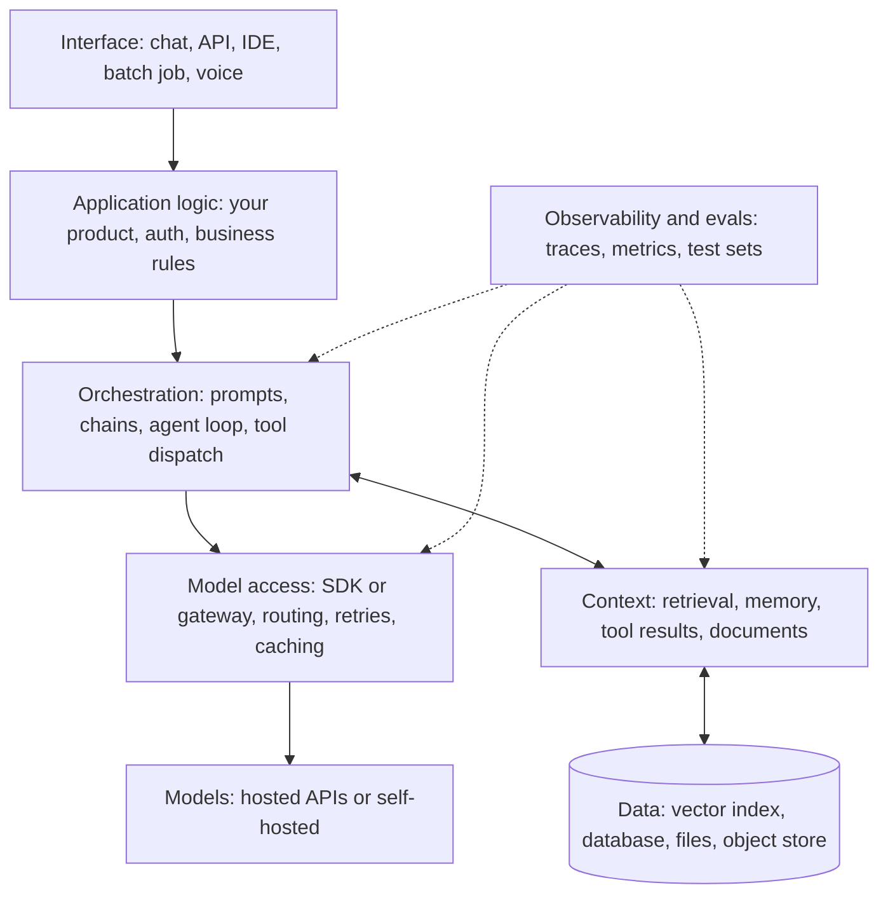
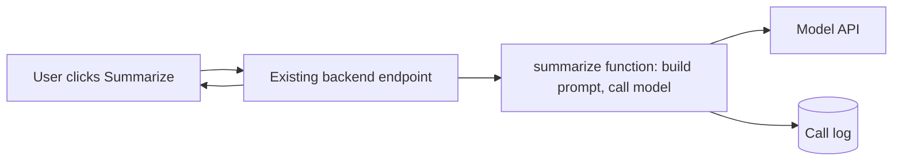
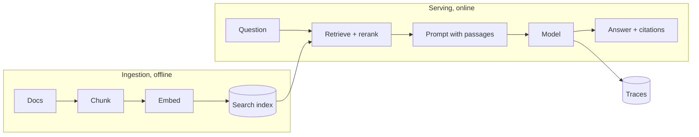
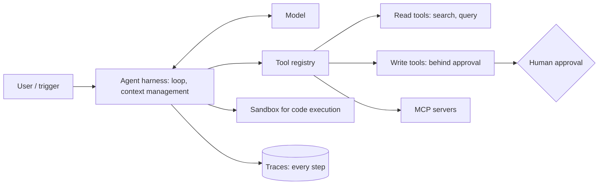

# 6. The AI stack

## After this chapter you will be able to

- Name the layers of a production LLM application and what each is responsible for.
- Decide which layers you need now and which can wait.
- Lay out a codebase so prompts, tools and evals are maintainable.

## The layers



| Layer | Responsibility | Minimal version | Grown-up version |
|---|---|---|---|
| **Models** | Generate text | One hosted API | Several models by task, with fallbacks |
| **Model access** | Call models reliably | Provider SDK with retries | Gateway: routing, rate limits, spend controls, caching, logging |
| **Context** | Supply the right information | Paste it into the prompt | Retrieval, memory, compaction |
| **Orchestration** | Decide what is called when | A function | Chains, routers, agent loops, tool registry |
| **Data** | Hold what you retrieve | Files or your existing database | Search index, vector store, sync pipelines |
| **Application** | Everything that is not AI | Your existing backend | Same, plus permissions enforced around tools |
| **Interface** | How people use it | CLI or simple chat | Streaming UI, citations, feedback buttons, approvals |
| **Observability and evals** | Know what happened and whether it was good | Log every call to a file | Tracing, eval suites in CI, dashboards, alerts |

Most of the code in an AI product is the application layer. The model call is often
ten lines; the rest is ordinary software.

## What to build first

A good order, because each step makes the next one measurable:

1. **Model call + logging.** From day one, record inputs, outputs, model, tokens and latency.
2. **A small eval set.** Twenty real examples with expected properties (chapter 9).
3. **Prompt in version control.** Treated as code, reviewed as code.
4. **Context.** Only when the evals show the model lacks information.
5. **Orchestration beyond one call.** Only when one call demonstrably is not enough.
6. **A gateway.** When you have several services or models, or need spend controls.

Teams that start with a vector database and an agent framework before they have logging
and evals are building blind.

## Frameworks: when to use one

Orchestration frameworks give you pre-built chains, agent loops, retrievers and
integrations.

| Use a framework when | Use the plain SDK when |
|---|---|
| You need many integrations quickly | The task is a call or a short chain |
| The pattern is standard (an agent with tools, basic RAG) | You need to see and control exactly what is sent to the model |
| Your team already knows it | You are still learning how these systems behave |

A healthy default: build your first version directly on the provider SDK. You learn
what the framework would hide, and you can adopt one later with informed opinions.
Whatever you choose, be able to print the exact final prompt sent to the model. If you
cannot see it, you cannot debug it.

## Three reference stacks

### A. The feature: an AI capability inside an existing product

Example: "summarize this thread" in a team chat app.



- Provider SDK, called from the existing backend.
- Prompt in a file under version control.
- Logs to the existing logging system.
- A script that runs 30 saved threads through the prompt and prints results for review.

No vector database. No framework. No agent.

### B. The knowledge assistant: chat over company documents



- Ingestion pipeline with document-level permissions carried into the index.
- Hybrid search plus a reranker (chapter 7).
- Streaming UI with citations and a thumbs up/down.
- Retrieval evals separate from answer evals.

### C. The agent: a system that takes actions



- An agent loop, either your own or from an agent SDK.
- Tools split into read (free to use) and write (gated).
- A sandbox for any code or shell execution.
- Step-level tracing, budgets on steps and spend, and end-state evals.

## Project layout

A layout that scales from one prompt to a real system:

```text
my-ai-app/
├── app/                    # your product: routes, auth, business logic
├── ai/
│   ├── prompts/            # one file per prompt, versioned, with a comment on its purpose
│   │   ├── summarize_thread.md
│   │   └── support_system.md
│   ├── tools/              # one module per tool: schema, description, implementation
│   ├── chains/             # multi-step workflows
│   ├── retrieval/          # ingestion, chunking, search
│   ├── schemas/            # output types (Pydantic / Zod)
│   └── client.py           # the single place that calls a model: retries, logging, model names
├── evals/
│   ├── datasets/           # inputs and expectations, as JSONL
│   ├── graders/            # code and model-based graders
│   └── run.py
├── tests/                  # ordinary unit tests; mock the model here
└── docs/
```

The principles behind it:

- **One choke point for model calls** (`client.py`). Logging, retries, model names and
  cost tracking live in one place. Changing a model is a one-line change.
- **Prompts are files, not string literals scattered through code.** They get reviewed,
  diffed and tested like code.
- **Model names in configuration**, never hard-coded in twenty places. Models are
  retired on a schedule, and you will migrate.
- **Evals sit beside the code** and run in CI.
- **Unit tests mock the model; evals call it.** They answer different questions:
  "does my code work?" versus "is the output good?".

## Build vs buy

| Component | Usually buy | Consider building when |
|---|---|---|
| Model | Hosted API | Strict data residency, very high volume, or offline use |
| Vector search | Your existing database's vector support, or a managed service | Rarely |
| Gateway | Open source or managed | Unusual routing or compliance needs |
| Observability | An LLM tracing tool | You already have strong tracing you can extend |
| Agent loop | An agent SDK | You need unusual control over context or tools |
| Evals | Start with a script; tools help later | Your quality criteria are highly domain-specific (they often are) |
| Prompts and tools | **Always yours** | This is your product |

## Common mistakes

- Choosing the stack before understanding the task.
- Adding a vector database when the documents would fit in the prompt.
- Prompts as inline strings, edited in production with no review.
- Model names and parameters scattered across the codebase.
- No logging of the actual prompt and response, so failures cannot be reproduced.
- Treating "which framework?" as the main design decision. It is one of the least important.

## Exercises

1. Draw the layer diagram for a system you know and mark each layer present, absent or
   improvised.
   *Good answer: you can name the weakest layer and what it costs you today.*
2. Write a `client` wrapper that calls a model and logs timestamp, model, prompt,
   response, token counts, latency and stop reason to a JSONL file.
   *Good answer: you can replay any logged call.*
3. Move one inline prompt in a project into its own file with a header comment stating
   its purpose, inputs and known failure cases.
   *Good answer: a colleague can understand the prompt's job without reading the calling code.*
4. For reference stack B, list what you would have to change to swap the model
   provider.
   *Good answer: the list is short because model access is isolated; if it is long, that is the finding.*

---
Previous: [5. Application architectures](05-application-architectures.md) · Next: [7. RAG and data](07-rag-and-data.md)
