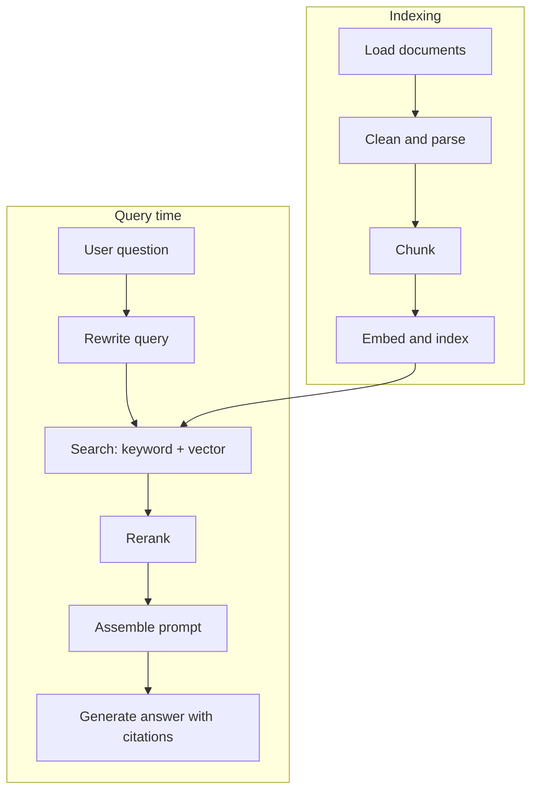
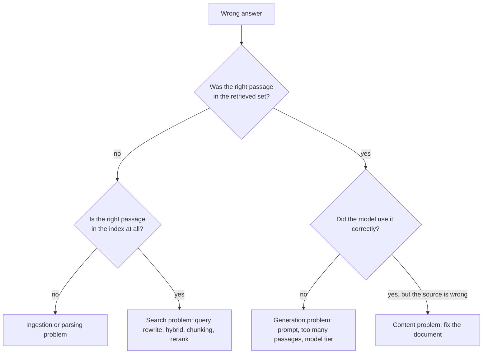

# 7. RAG and data

## After this chapter you will be able to

- Decide whether a problem needs retrieval at all.
- Build a retrieval pipeline and name the choice made at each stage.
- Debug a bad answer by locating which stage failed.

## What RAG is

Retrieval-augmented generation means: at request time, search your data for material
relevant to the question, put it in the prompt, and have the model answer from it.

It exists because models do not know your data, cannot be retrained every time a
document changes, and answer more accurately from text in front of them than from memory.

## First question: do you need it?

| Situation | Approach |
|---|---|
| All relevant content fits in the context window with room to spare | **Put it all in.** Use prompt caching (chapter 10) to keep it cheap. Simpler and often more accurate. |
| Content is larger than the window, or changes constantly | Retrieval |
| The question needs exact lookups (order 4417's status) | A database query via a tool, not semantic search |
| The question needs aggregation ("how many tickets mention refunds?") | SQL or analytics via a tool, not RAG |
| The model needs a skill or style, not facts | Better prompting and examples; possibly fine-tuning |

Many "RAG projects" should have been a long prompt or a SQL tool.

## The pipeline



A failure at any stage produces the same symptom, a bad answer, so you need to know
the stages to find which one broke.

### Load and parse

Unglamorous and decisive. If a PDF's tables come out as scrambled text, no later stage
can recover. Check the parsed text of real documents by eye. Keep metadata: title,
source URL, section, date, author, access permissions.

### Chunk

Documents are split into passages, because you retrieve passages, not whole files.

- **Split on structure** where it exists: headings, sections, functions, list items.
  A chunk should be something a person could read alone and understand.
- **Size** is a trade-off. Small chunks are precise and lose context. Large chunks keep
  context and dilute relevance. A few hundred tokens is a common starting point; tune
  with evals.
- **Overlap** adjacent chunks slightly so a sentence cut at a boundary survives in one.
- **Add context to each chunk.** A chunk reading "This limit rises to 50 for enterprise
  plans" is useless alone. Prepending the document title and section heading, or a
  one-line model-written summary of where the chunk sits, substantially improves retrieval.

### Embed and index

An embedding model maps text to a vector such that similar meanings are close together.
A vector index finds nearest neighbors fast.

- Use the same embedding model for documents and queries.
- Changing embedding models means re-embedding everything. Record which model built the index.
- Your existing database may already support vector search. That is often enough.

### Search: use both kinds

| | Finds | Misses |
|---|---|---|
| **Vector (semantic) search** | Paraphrases, related concepts | Exact terms: error codes, product names, IDs |
| **Keyword search (BM25)** | Exact terms, rare words | Synonyms, different phrasing |

**Hybrid search** runs both and merges the results. It is the sensible default, because
real queries mix both needs: "why do I get ERR_4012 when syncing?" has an exact code
and a fuzzy concept.

Also use **metadata filters** (date range, product, language, permission) to narrow
before or during search.

### Rewrite the query

Users write "and what about for teams?". Searching for that literal string finds
nothing. A small model call that rewrites the latest message into a standalone search
query, using conversation history, fixes a large class of failures. For complex
questions, generate several queries and merge results.

### Rerank

First-stage search is fast and approximate. A **reranker** is a model that scores each
candidate passage against the query more carefully. Retrieve broadly (say 50), rerank,
keep the best few (say 5 to 10). This is often the single highest-value addition to a
basic pipeline.

### Assemble and generate

```text
Answer the question using only the passages below. Each passage has an id.

<passages>
<passage id="1" source="billing-faq.md" updated="2026-09-02">...</passage>
<passage id="2" source="plans.md" updated="2026-10-14">...</passage>
</passages>

Rules:
- Cite the passage id after each claim, like [2].
- If the passages do not contain the answer, say so and suggest what the user could
  ask or where they could look. Do not answer from general knowledge.
- If passages conflict, prefer the more recently updated one and mention the conflict.

Question: {question}
```

The three rules are the difference between a grounded assistant and a confident guesser.

## Debugging: retrieval or generation?

When an answer is wrong, look at what was retrieved.



Measure the two halves separately:

- **Retrieval metrics:** for a set of questions with known relevant passages, how often
  is a relevant passage in the top k (recall@k)?
- **Generation metrics:** given the right passages, is the answer correct, grounded and cited?

Teams that tune the prompt for weeks when the right passage was never retrieved are
common. Check retrieval first.

## Beyond basic RAG

- **Agentic retrieval.** Give a model a search tool and let it search, read, and search
  again. Better for multi-hop questions ("compare our 2024 and 2025 refund policies").
  Slower and costlier.
- **Structured data.** For tables and databases, let the model write a query (through a
  safe, read-only tool) instead of embedding rows.
- **Knowledge graphs** help when relationships between entities matter more than
  passages. High build cost; adopt only with a clear need.

## Data concerns that become emergencies if ignored

- **Permissions.** Retrieval must respect who is asking. Filter by the user's access at
  query time, enforced in code. "The model will know not to reveal it" is not access control.
- **Freshness.** Decide how soon a changed document must be reflected, and build the
  sync to match. Delete from the index what is deleted at the source.
- **Untrusted content.** Retrieved documents can contain instructions aimed at the
  model. See chapter 11.

## Bad vs good: the RAG answer prompt

**Bad prompt**
```text
Here is some context: {chunks}

Question: {question}
```
**Why it fails**: Nothing says to stay within the context, nothing permits "not found",
there are no sources to cite, and chunks run together with no boundaries.

**Better prompt**: the template in "Assemble and generate" above.

**What changed**: Delimited, identified passages; a grounding rule; a not-found path; a
conflict rule; citations that let users and evals verify the answer.

## Common mistakes

- Building RAG when the content fits in the prompt.
- Vector search only, missing exact-term queries.
- Chunking by fixed character count through the middle of tables and code.
- Never reading the retrieved passages for failing questions.
- Evaluating only the final answer, so you cannot tell which half is broken.
- Ignoring document permissions until a demo leaks something.
- Retrieving 40 passages "to be safe", burying the relevant one.

## Exercises

1. Take 20 pages of documentation and ten questions. Answer them with the whole corpus
   in the prompt, no retrieval. Record accuracy and cost.
   *Good answer: a baseline you must beat before any RAG system is justified.*
2. Build minimal retrieval over the same corpus with vector search only. Find a question
   containing an exact identifier that it fails on, then add keyword search.
   *Good answer: a concrete query where hybrid succeeds and vector-only fails.*
3. For five wrong answers, walk the debugging flowchart and label each failure by stage.
   *Good answer: a tally by stage that tells you where to invest next.*
4. Add document title and heading to each chunk before embedding. Compare recall@5 on
   your ten questions.
   *Good answer: before and after numbers.*
5. Ask a question whose answer is not in the corpus.
   *Good answer: the system says it does not know. If it answers anyway, fix the prompt and add this case to your evals.*

---
Previous: [6. The AI stack](06-the-ai-stack.md) · Next: [8. Agents and tool use](08-agents-and-tool-use.md)
