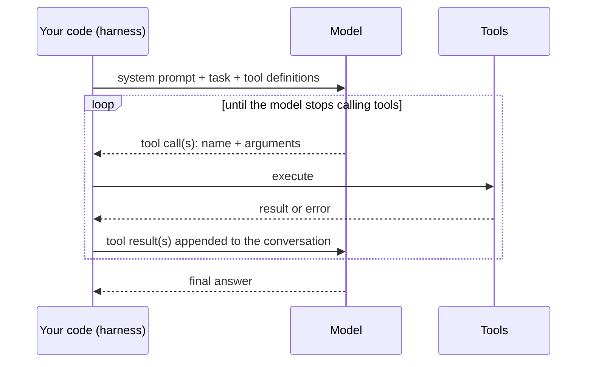
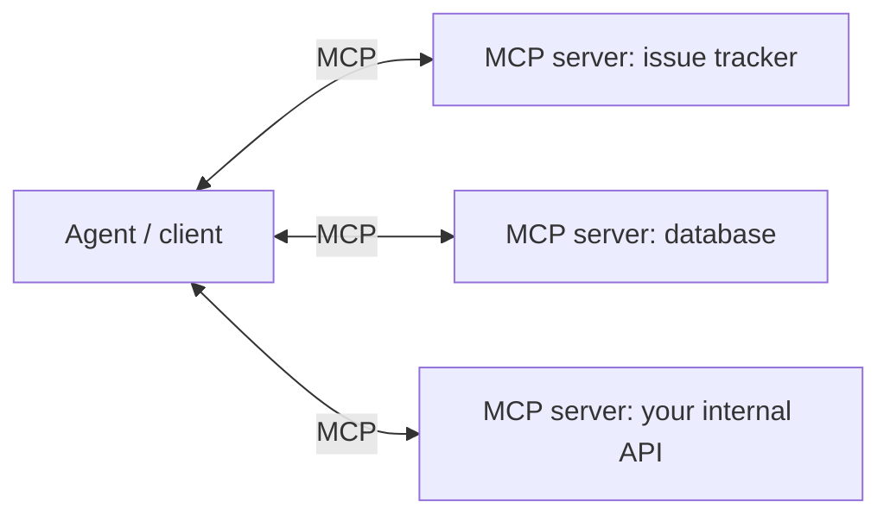

# 8. Agents and tool use

## After this chapter you will be able to

- Implement the agent loop and explain every message in it.
- Design tools a model uses correctly.
- Manage context over long tasks, and decide when to use multiple agents.

## What an agent is

An agent is a model in a loop with tools, working toward a goal, deciding its own next
step. That is the whole definition. The engineering is in the tools, the context, and
the limits.

## The loop



In code:

```python
def run_agent(task, tools, max_steps=25):
    messages = [user(task)]
    for step in range(max_steps):
        response = llm.generate(system=SYSTEM, messages=messages, tools=tools.schemas)
        messages.append(response.as_assistant_message())

        if not response.tool_calls:
            return response.text                       # the model considers itself done

        results = []
        for call in response.tool_calls:
            try:
                output = tools.execute(call.name, call.arguments)
                results.append(tool_result(call.id, output))
            except Exception as err:
                results.append(tool_result(call.id, f"Error: {err}", is_error=True))
        messages.append(user(results))

    raise StepLimitReached(messages)
```

Things to notice:

- **The model never executes anything.** It asks; your code decides whether and how to
  run it. This is where you enforce permissions.
- **Errors go back to the model as results.** A good error message lets it recover.
- **There is a step limit.** Always. Also budget tokens and wall-clock time.
- **The whole history is re-sent each turn**, so long tasks grow expensive. See
  "Context engineering" below.

> **Provider notes**
> All major APIs follow this request/response shape, with different names: tool use
> blocks and tool results (Anthropic), function calls and outputs (OpenAI), function
> call and response parts (Gemini). Most can return several tool calls in one turn;
> run independent ones in parallel. Providers also host some tools themselves, such as
> web search and code execution, which run server-side and need no loop code from you.

## Designing tools

Tool design is the highest-leverage work in agent building. A model with five clear
tools outperforms the same model with thirty muddled ones.

### Write the description as a prompt

The model sees only the name, the description and the parameter schema. Include: what
it does, when to use it, when not to, what it returns, and input tips. See pair 16 in
chapter 3.

### Design for the task, not for your API

Do not wrap every REST endpoint one-to-one. Offer tools that match what the agent is
trying to accomplish.

```text
Weak:   list_users(), get_user(id), list_events(user_id), get_event(id)
        -> four calls and a lot of irrelevant JSON to answer one question
Better: find_customer_activity(email, since)
        -> one call returning a compact summary
```

### Return what the model needs, compactly

Tool results consume context. Return the relevant fields, not a 5,000-line payload.
Offer pagination, filters and a `detail: "summary" | "full"` option. Use readable names
over opaque IDs where possible.

### Make errors instructive

```text
Weak:   Error: 400
Better: Error: start_date must be YYYY-MM-DD; received "last Tuesday".
        Today is 2026-11-11.
```

### Make misuse hard

Use enums, required fields and validation. If two parameters must not be combined,
enforce that in code and say so in the error.

### Separate reading from acting

| Kind | Examples | Policy |
|---|---|---|
| Read | search, query, fetch, list | Allow freely |
| Reversible write | create draft, add label, write to a sandbox | Allow, log |
| Irreversible or external | send email, charge card, delete data, deploy | Require approval, or do not offer |

The safest tool is the one you did not give the agent. Constraints belong in code, not
in a line of the prompt asking the model to be careful.

### Keep the set small and distinct

If you cannot tell which of two tools applies to a situation, neither can the model.
Merge overlapping tools. When the catalogue is large, load tool definitions on demand
through a search step instead of putting hundreds in every request.

## MCP: a standard plug for tools

The **Model Context Protocol** is an open standard for connecting models to tools and
data. A service is wrapped once as an MCP server; any MCP-capable client (an IDE, a
chat app, your own agent) can use it.



Use MCP when a tool should be shared across several agents or products, or when a
server already exists for the service you need. For a tool used by one application, a
plain function is simpler. Treat third-party MCP servers like any dependency: they run
with whatever access you grant them (chapter 11).

## Writing the agent's system prompt

An agent prompt needs what a chat prompt needs, plus guidance on *how to work*:

```text
You resolve failing CI builds for the payments-api repository.

Goal: a green build with the smallest correct change. Engineers review your diff, so
clarity matters more than cleverness.

How to work:
- Start by reading the failing job's log before touching code.
- Reproduce the failure locally before fixing it, and re-run the same check afterwards.
- Make one hypothesis at a time. If a fix does not work, revert it before trying the next.
- If you have tried three approaches without progress, stop and report what you
  learned instead of continuing.

Boundaries:
- You may edit files and run tests. You may not push, merge, or change CI
  configuration; those need a human.
- Never make a test pass by deleting or skipping it. If a test looks wrong, say so.

When done, report: the root cause, what you changed and why, what you ran to verify,
and anything you are unsure about.
```

Note what it contains: a goal, a working method, a stopping condition, boundaries with
the enforcement left to code, and a report format.

## Context engineering

On long tasks the limiting resource is the context window. Managing it is a discipline
of its own.

**What fills it:** tool definitions, every tool result, every file read, every failed attempt.

**Techniques:**

- **Trim at the source.** Compact tool results beat cleanup later.
- **Compaction.** When the context is nearly full, summarize the history so far (goal,
  decisions, current state, next steps) and continue from the summary.
- **Clear stale tool results.** Old outputs that have been acted on can be dropped.
- **Notes on disk.** Have the agent maintain a progress file. It survives compaction
  and lets a fresh context resume the work.
- **Sub-agents for exploration.** A search that reads forty files returns only its
  conclusion to the main context.
- **Just-in-time loading.** Give the agent pointers (file paths, links, search tools)
  rather than preloading everything.

A useful mental model: the context is the agent's working memory, the file system is
its long-term memory, and your job is to decide what goes where.

## Memory across sessions

Agents forget between sessions unless you store something. The simple, effective
pattern is a file or small store the agent reads at the start and updates at the end:
user preferences, project conventions, lessons from past mistakes.

Keep memory short, specific and current. Stale memory is worse than none, since the
agent trusts it.

## Multiple agents

Use more than one agent when:

- **Work is parallel and independent** (research five competitors at once).
- **A sub-task is noisy** and would flood the main context.
- **You want an independent check** by a reviewer that has not seen the author's reasoning.

Costs: several times the tokens, lossy handoffs, and harder debugging. The delegation
brief is the sub-agent's entire world; see pair 18 in chapter 3. Ask sub-agents to
separate what they verified from what they inferred, and verify claims that matter.

## Humans in the loop

Good agent products are designed around where a person is needed:

- **Before:** agree on the plan for large or risky tasks.
- **During:** approve irreversible actions.
- **After:** review the result (a diff, a draft, a report), with evidence attached.

Aim for the agent to be autonomous on what is cheap to undo and to pause on what is not.

## Bad vs good: agent instructions

**Bad prompt**
```text
You are an autonomous agent. Complete the user's task using the tools. ALWAYS verify
your work. NEVER make mistakes.
```
**Why it fails**: No goal, no method, no boundaries, no definition of done. The capital
letters add anxiety without information.

**Better prompt**: the CI example above.

**What changed**: Concrete working method, a stopping rule for when it is stuck,
boundaries, and a report format that makes review fast.

## Common mistakes

- No step, token or time limit.
- Tool results that dump raw API responses.
- Thirty overlapping tools.
- Relying on the prompt to prevent a dangerous action instead of removing the capability.
- Swallowing tool errors, so the model never learns the call failed.
- Letting context fill until the agent loses the original goal.
- Building a multi-agent system before a single agent has been shown to fall short.
- Evaluating by watching one run. Agents vary; run tasks several times (chapter 9).

## Exercises

1. Implement the loop above with two tools: `read_file` and `list_directory`, restricted
   to one folder. Ask it a question that needs both.
   *Good answer: a transcript where you can identify every message type, and a path check that refuses access outside the folder.*
2. Deliberately write a vague tool description and observe misuse. Rewrite it.
   *Good answer: a before/after transcript showing the wrong call disappear.*
3. Make a tool return a huge payload, then add a `fields` parameter and a summary mode.
   Compare tokens used across a task.
   *Good answer: token counts for both versions.*
4. Give the agent a task it cannot complete with its tools.
   *Good answer: it reports that clearly. If it fabricates success, strengthen the prompt and add the case to your evals.*
5. Add a `send_email` tool that requires approval. Enforce the approval in the harness.
   *Good answer: even with the system prompt rewritten to say "never ask for approval", the email cannot be sent without it.*

---
Previous: [7. RAG and data](07-rag-and-data.md) · Next: [9. Evals](09-evals.md)
