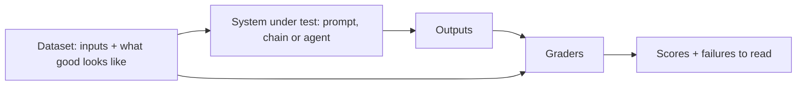
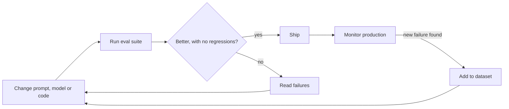

# 9. Evals

## After this chapter you will be able to

- Build an eval set from nothing in an afternoon.
- Choose between code graders, model graders and human review.
- Use evals to change prompts and models without fear.

## Why evals are the core skill

Without evals, every prompt change is a guess, every model upgrade is a risk, and
"it seems better" is the only evidence you have. With evals, you can state: "version 7
passes 46 of 50, version 6 passed 41, and here are the four that still fail."

An eval is a test for output quality. It has three parts:



## Start small, start today

You do not need a platform. You need a file.

1. Collect **20 to 50 real inputs.** From logs, from support tickets, from your own use.
   If you have none, write them, covering the variety you expect.
2. For each, write **what a good output must have**. Not necessarily the full expected
   answer: "mentions the 30-day limit", "label is `billing`", "does not promise a refund".
3. Run them. **Read every output.**
4. Note each failure and its cause. Fix the prompt. Re-run.

That is an eval. Everything else is automating the reading.

```jsonl
{"id": "t01", "input": "I was charged twice this month", "expect": {"label": "billing", "must_mention": ["duplicate charge"], "must_not": ["refund has been issued"]}}
{"id": "t02", "input": "how do i export to csv", "expect": {"label": "how_to"}}
```

## What goes in the dataset

| Kind of case | Why |
|---|---|
| Typical inputs | The bulk of real traffic |
| Edge cases | Empty input, very long input, other languages, typos, mixed intents |
| Past failures | Every bug you fix becomes a regression test |
| Adversarial inputs | Prompt injection, off-topic requests, attempts to break rules (chapter 11) |
| "Should decline" cases | Questions the system must not answer or cannot know |

Keep inputs realistic. Polished, well-formed test questions hide the failures that
messy real ones reveal. Keep a held-out portion you do not tune against, so you can
detect overfitting to your own test set.

## Graders

### Code graders: use wherever possible

Fast, free, deterministic.

```python
def grade_label(output, expect):
    return output["label"] == expect["label"]

def grade_must_mention(text, expect):
    return all(term.lower() in text.lower() for term in expect.get("must_mention", []))

def grade_valid_sql(sql):
    return parses(sql) and is_read_only(sql)
```

Good for: exact labels, schema validity, required or forbidden strings, numeric
tolerance, "does the code compile", "do the tests pass", "does the cited passage id exist".

### Model graders: for qualities code cannot check

A second model call judges the output against a rubric ("LLM as judge").

```text
You are grading a customer support reply.

<customer_message>{input}</customer_message>
<reply>{output}</reply>
<policy>{relevant_policy}</policy>

Criterion: the reply makes no claim that contradicts the policy.

First quote any sentences in the reply that make a factual claim about policy, and
the policy text each relates to. Then decide.

Finish with exactly one line: VERDICT: PASS or VERDICT: FAIL
```

Rules for judges you can trust:

- **One criterion per judge.** "Rate overall quality 1 to 10" produces noise. A binary
  question about one property produces signal.
- **Evidence before verdict.** Ask it to quote, then decide.
- **Give it the reference material.** A judge cannot check accuracy against a policy it
  has not been shown.
- **Calibrate against humans.** Label 30 to 50 outputs yourself, run the judge, and
  measure agreement. Fix the rubric until agreement is high. Re-check periodically.
- **Use a capable model** for judging, and where you can, a different one from the
  model being judged.

### Human review: the ground truth

Humans define what "good" means and calibrate the automated graders. Regularly read a
sample of production outputs. No dashboard replaces this.

| Grader | Cost | Speed | Use for |
|---|---|---|---|
| Code | Free | Instant | Anything objectively checkable |
| Model | Low | Seconds | Tone, groundedness, relevance, policy compliance |
| Human | High | Slow | Defining the standard, calibrating judges, auditing |

## Reading results

A score is a summary. The failures are the information.

- **Read the failures**, group them by cause, fix the largest group first.
- **Compare versions case by case**, not only by total. A change that fixes five and
  breaks three is a different thing from one that fixes two and breaks none.
- **Mind the noise.** With 30 cases, one flip moves the score by three points. Run
  non-deterministic systems several times and look at the spread before declaring a winner.
- **Track cost and latency** alongside quality. A two-point gain for triple the cost is
  a business decision, not an automatic win.

## Evaluating different architectures

**RAG.** Evaluate retrieval and generation separately (chapter 7). Retrieval: is the
right passage in the top k? Generation: given the right passages, is the answer
correct, grounded and cited? Plus: does it decline when the answer is absent?

**Agents.** Grade the **end state**, not the path. Did the tests pass? Is the record in
the database correct? Is the file what it should be? There are many valid routes, and
grading the exact tool sequence punishes good ones. Also track steps, tokens and time
per task, and run each task several times, because one success tells you little about
reliability. Useful secondary checks: no forbidden action taken, no fabricated claim of
success.

**Conversations.** Use scripted multi-turn cases, or a second model playing a user with
a stated goal and persona, then grade the whole transcript.

## Evals in the development loop



- **Run evals in CI** on changes to prompts, tools or model configuration. A fast
  subset on every change; the full suite before release.
- **Feed production back in.** Thumbs-down responses, escalations and bug reports
  become new cases.
- **When a new model ships,** run the suite. You will know in an hour whether to
  migrate, instead of in a month.

## Worked example

A ticket classifier with four labels. First run: 41 of 50.

Reading the nine failures:

| Count | Pattern | Fix |
|---|---|---|
| 5 | Tickets with two issues get the less important label | Add a tie-break rule: "label by what the customer asks us to do" |
| 3 | "Cancel my subscription" labeled `billing`, team expects `account` | Definitions overlapped; rewrite both with a boundary example |
| 1 | The expected label in the dataset was wrong | Fix the dataset |

Second run: 47 of 50. Two of the remaining three are ambiguous even to humans; the team
adds a `needs_human` label for them. The third becomes a known issue with a test.

Note the last row of the table. Evals find errors in your own expectations too.

## Bad vs good: a judge prompt

**Bad prompt**
```text
Rate this answer from 1 to 10.
```
**Why it fails**: No criterion, no reference, no evidence. Scores cluster around 7 and
mean nothing.

**Better prompt**: the support-reply judge above.

**What changed**: One criterion, reference material supplied, evidence required before
a binary verdict in a parseable format.

## Common mistakes

- No evals, "because the output is subjective". Subjective qualities can still be
  broken into specific checkable criteria.
- Waiting for a perfect dataset. Twenty cases today beat five hundred next quarter.
- Looking at the score and not the outputs.
- A single vague "quality" judge.
- An uncalibrated judge trusted as truth.
- Tuning until the test set passes, with nothing held out.
- Declaring a winner on one run of a noisy system.
- Evals that take hours, so nobody runs them.

## Exercises

1. Build a 20-case dataset for a prompt you own, with at least three edge cases and two
   "should decline" cases. Run it and read every output.
   *Good answer: a list of failures grouped by cause.*
2. Write code graders for whatever in your outputs is objectively checkable.
   *Good answer: at least half of your criteria now need no human reading.*
3. Write a model grader for one subjective criterion. Label 30 outputs yourself and
   measure agreement.
   *Good answer: an agreement rate, and a rubric revision that raised it.*
4. Make a deliberate prompt change you believe is an improvement. Compare case by case.
   *Good answer: a list of cases fixed and cases broken, and a decision.*
5. Run your suite five times unchanged.
   *Good answer: you know the run-to-run spread, and therefore how big a difference must be before you believe it.*

---
Previous: [8. Agents and tool use](08-agents-and-tool-use.md) · Next: [10. Production](10-production.md)
