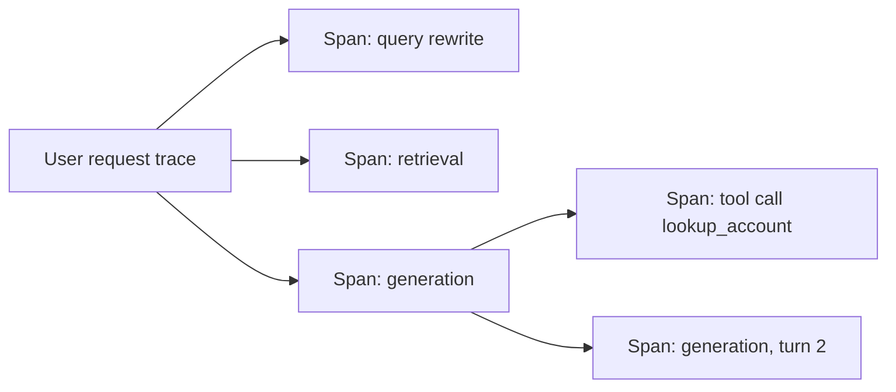

# 10. Production

## After this chapter you will be able to

- Estimate and reduce the cost and latency of an LLM feature.
- Make a system resilient to provider errors, rate limits and model changes.
- Instrument a system so you can explain any output after the fact.

## The four budgets

Every production LLM feature lives inside four budgets that trade against each other:

| Budget | Driven by |
|---|---|
| **Quality** | Model tier, prompt, context, architecture |
| **Latency** | Output length, model tier, number of sequential calls, reasoning effort |
| **Cost** | Tokens in and out, model tier, number of calls |
| **Reliability** | Retries, fallbacks, validation, limits |

Decide the targets before optimizing. "Under two seconds to first token, under a cent
per request, 95% on the eval suite" is a spec you can engineer towards.

## Cost

```
cost per request = Σ over calls (input_tokens × input_price + output_tokens × output_price)
```

Measure first: log tokens per call and aggregate by feature. The expensive thing is
rarely what you assumed.

Levers, roughly in order of payoff:

1. **Prompt caching.** If many requests share a long prefix (system prompt, tool
   definitions, a large document), providers can cache it and bill repeat reads at a
   steep discount. The rule that makes it work: **stable content first, variable
   content last**, and keep the prefix byte-for-byte identical. A timestamp at the top
   of your system prompt silently defeats it.
2. **Right-size the model.** Route easy cases to a small model; escalate hard ones.
   Verify with evals.
3. **Trim the input.** Fewer, better-chosen passages. Compact tool results. Drop stale history.
4. **Trim the output.** Ask for less. Output tokens cost more and take longer.
5. **Batch.** Work that is not time-sensitive (nightly classification, backfills, eval
   runs) can go through batch APIs at a significant discount.
6. **Cache whole responses** for genuinely identical requests.
7. **Avoid calls.** Does this step need a model, or would a regex or a lookup do?

> **Provider notes**
> Caching differs by provider: some require you to mark cache points explicitly, some
> cache automatically above a minimum size, and cache lifetimes and prices differ.
> Batch discounts and turnaround times also vary. Check current pricing pages; this is
> one of the fastest-changing areas.

## Latency

Users feel two numbers: **time to first token** and **total time**.

- **Stream.** Showing text as it is generated makes a ten-second response feel
  responsive. For anything user-facing, stream by default.
- **Shorten output.** Usually the largest single lever on total time.
- **Parallelize** independent calls and independent tool executions.
- **Use a smaller model** for steps that do not need the large one (routing, query
  rewriting, simple extraction).
- **Reduce sequential hops.** Every chained call adds a full round trip. Can two steps merge?
- **Tune reasoning effort.** Deep thinking on a trivial request is wasted time.
- **Cache** prompts and results; cached prefixes are also faster to process.
- **Do work ahead of time.** Precompute summaries and embeddings offline.
- **Show progress.** For agents, display what is happening. Perceived latency matters.

## Reliability

Model APIs fail like any network service, and in a few ways of their own.

| Failure | Handling |
|---|---|
| Rate limit (429) | Retry with exponential backoff and jitter; respect retry-after headers; queue and smooth bursts |
| Overloaded / 5xx | Retry with backoff; then fall back to another model or provider |
| Timeout | Set timeouts deliberately; streaming avoids idle-connection timeouts on long generations |
| Truncated output | Check the stop reason; continue or retry with a higher limit |
| Refusal or empty output | Detect it, handle it as a distinct case, do not pass it downstream as a result |
| Invalid structure | Validate; retry with the error; then dead-letter (chapter 4) |
| Context too long | Count tokens before sending; trim or compact |
| Quality regression after a model update | Pin versions; run evals before upgrading |

Principles:

- **Timeouts, retries and a cap on retries** on every call.
- **Idempotency** for anything with side effects, so a retry does not send the email twice.
- **Graceful degradation.** If the AI feature is down, the product should still work,
  with the feature hidden or a simpler fallback in its place.
- **Budgets on agents.** Maximum steps, tokens and spend per task, enforced in code.
- **Pin model versions.** Use dated or versioned model identifiers rather than a moving
  alias in production, and upgrade deliberately. Models are deprecated on published
  schedules; put the dates on a calendar.

## Observability

You need to answer, for any output: **what exactly went in, what came out, and what
happened in between.**

Record per model call:

- Trace and span IDs linking it to the user request
- Model identifier and parameters
- Prompt version
- Full input and output (subject to your privacy rules)
- Token counts including cached tokens, latency, time to first token
- Stop reason, tool calls made, errors and retries



Tracing an agent step by step is the only practical way to debug one.

Dashboards worth having: cost per feature per day; latency percentiles (p50, p95, p99);
error and retry rates; cache hit rate; eval scores over time; user feedback rate.

**Online quality signals.** Thumbs up/down, edits to generated text, regenerate clicks,
escalations to a human, task completion. Sample production outputs through your model
graders. Read some by hand every week.

**Privacy.** Logs of prompts contain whatever users typed. Decide retention, access and
redaction deliberately, and before you have a year of sensitive data in a log bucket.

## Shipping changes safely

Prompts and models are code. Deploy them like code.

1. Change in a branch; review the diff.
2. Run the eval suite; compare case by case to the current version.
3. Roll out behind a flag to a small share of traffic.
4. Watch quality signals, cost and latency.
5. Ramp up or roll back.

Keep the previous prompt version deployable. A rollback should be a config change.

## Worked example: cutting a feature's cost by most of it

A document Q&A feature. Each request sends a 15,000-token product manual, a 600-token
system prompt and a short question to the largest model. Answers average 400 tokens.

| Step | Change | Effect |
|---|---|---|
| 1 | Measure | Input tokens are 97% of the spend; the manual is identical in every request |
| 2 | Enable prompt caching with the manual and system prompt as the stable prefix | Input cost falls sharply; time to first token improves |
| 3 | Run evals on the mid-tier model | 48/50 against 49/50; switch, and route the two failing question types to the large model |
| 4 | Ask for answers in "three sentences unless the user asks for detail" | Output tokens and latency drop by more than half |
| 5 | Cache answers to the 30 most frequent identical questions | A slice of traffic costs nothing |

No architecture change, no new infrastructure. Measure, then pull the biggest lever.

## Bad vs good: a cache-friendly prompt

**Bad prompt**
```text
Current time: 2026-11-11T09:42:17Z. Request ID: 8f3a...
You are a support assistant for Ledgerly. [3,000 tokens of policy]
```
**Why it fails**: The first line changes on every request, so nothing after it can be
served from cache. You pay full price for 3,000 identical tokens each time.

**Better prompt**
```text
[system] You are a support assistant for Ledgerly. [3,000 tokens of policy]
[user]   <context>Today is 2026-11-11.</context> {question}
```
**What changed**: Stable content first, volatile content last. Same information,
a fraction of the cost.

## Common mistakes

- Optimizing cost before measuring where it goes.
- Volatile content at the start of the prompt, defeating caching.
- No streaming on user-facing generation.
- Retrying without backoff, turning a rate limit into an outage.
- Retrying non-idempotent tool calls.
- Using a floating model alias in production and being surprised by a behavior change.
- Logging nothing, or logging everything forever with no privacy review.
- An agent with no spend cap.

## Exercises

1. For a feature you run, compute cost per request from logged tokens and current prices.
   *Good answer: a number, and which component dominates it.*
2. Restructure a prompt so its stable part is a cacheable prefix. Confirm cache hits in
   the usage data returned by the API.
   *Good answer: cached-token counts greater than zero on the second request.*
3. Add streaming to a non-streaming call and measure time to first token against total time.
   *Good answer: two numbers and a note on how the experience changed.*
4. Implement retry with exponential backoff and jitter, a retry cap, and a fallback
   model. Test it by simulating 429 and 500 responses.
   *Good answer: a test that passes with the primary "down".*
5. Write the rollback procedure for a bad prompt deploy.
   *Good answer: it is short, and you have rehearsed it once.*

---
Previous: [9. Evals](09-evals.md) · Next: [11. Security and safety](11-security-and-safety.md)
