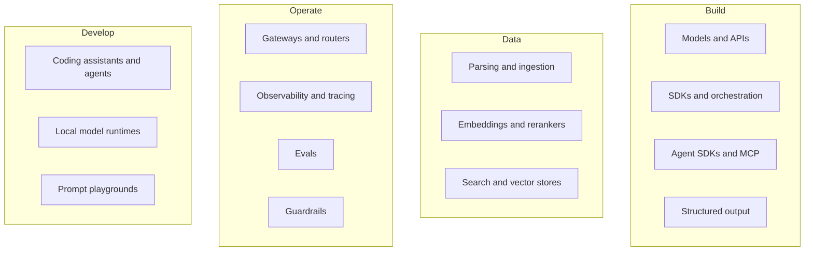

# 13. The tools landscape

## After this chapter you will be able to

- Name the categories of tooling in the AI engineering ecosystem and what each is for.
- Choose a tool by criteria instead of by popularity.
- Assemble a starter toolkit and know what to add later.

> **Read this first.** This chapter is a map as of November 2026. Tools named here are
> representative examples to anchor each category, not endorsements or a ranking, and
> the list is not complete. Products change, merge and disappear quickly. Use the
> categories and selection criteria as the durable part, and check current
> documentation before committing to anything.

## The map

## How to choose anything

Ask these before comparing features:

1. **What problem do I have today?** Not next year. Adopt tools in response to pain.
2. **Can I see what it sends to the model?** If it hides the prompt, debugging will hurt.
3. **How hard is it to leave?** Prefer open formats and thin layers.
4. **Does it fit what the team already runs?** The database you have beats the one you would have to operate.
5. **What does it do with my data?** Retention, training use, residency, compliance.
6. **Is it maintained?** Release cadence, issue response, documentation quality.

## Models and APIs

| Category | Examples | Pick when |
|---|---|---|
| Frontier model APIs | Anthropic (Claude), OpenAI (GPT), Google (Gemini) | You want top capability with no infrastructure |
| Cloud platforms hosting several model families | Amazon Bedrock, Google Vertex AI, Microsoft Foundry | Procurement, compliance or existing cloud commitments point that way |
| Open-weight models via hosted inference | Meta Llama, Mistral, Qwen, DeepSeek and others, served by various inference providers | Cost at high volume, customization, or avoiding dependence on one vendor |
| Self-hosted open models | The same models on your own hardware | Strict data control, offline use, or very high steady volume |

Selection criteria: quality on **your** evals (not public leaderboards); price; latency;
context size; tool-use and structured-output reliability; modalities (vision, audio);
rate limits; data terms.

Feature availability can differ between a provider's own API and the same model on a
cloud platform. Check before you depend on a feature.

## SDKs and orchestration

| Category | Examples | Pick when |
|---|---|---|
| Provider SDKs | The official Python and TypeScript SDKs from each provider | Default. Full feature access, least abstraction |
| Multi-provider interfaces | Vercel AI SDK, LiteLLM | You call several providers and want one interface; streaming UIs in TypeScript |
| Orchestration frameworks | LangChain, LangGraph, LlamaIndex, Haystack | You want pre-built chains, retrievers, integrations, or graph-style workflows |
| Typed, lightweight frameworks | Pydantic AI, Mastra | You want structure without a large framework |
| Prompt programming and optimization | DSPy | You want to optimize prompts against a metric programmatically |

Start with the provider SDK (chapter 6). Add a framework when you can name what it
saves you.

## Agent SDKs and MCP

| Category | Examples | Pick when |
|---|---|---|
| Agent SDKs | Claude Agent SDK, OpenAI Agents SDK, Google Agent Development Kit | You want a ready agent loop with tools, context management and permissions |
| Graph and multi-agent frameworks | LangGraph, CrewAI, AutoGen | You need explicit state machines or role-based multi-agent setups |
| Tool protocol | Model Context Protocol (MCP) servers and clients | Tools should be reusable across agents and apps |
| Sandboxes for code execution | Container and microVM services such as E2B, Modal, Daytona | Agents run code and you need isolation |
| Browser and computer control | Playwright-based tools, provider computer-use tools | The task has no API and must go through a UI |

Selection criteria: control over context and tool permissions; tracing; how easily you
can drop down to the raw loop; whether it locks you to one model provider.

## Structured output

| Category | Examples | Pick when |
|---|---|---|
| Native structured output | Each provider's schema-constrained output feature | Default |
| Schema and validation libraries | Pydantic (Python), Zod (TypeScript) | Always, for validating and typing results |
| Helper libraries | Instructor, Outlines | You want retries and validation wired up, or constrained decoding on local models |

## Data: parsing, embeddings, search

| Category | Examples | Pick when |
|---|---|---|
| Document parsing | Unstructured, Docling, LlamaParse, cloud document AI services; or a vision-capable model reading pages directly | PDFs, slides, scans and tables need to become clean text |
| Embedding models | Offered by OpenAI, Google, Cohere, Voyage AI and others; open models such as the BGE and E5 families | Choose by retrieval quality on your data, language coverage, cost and dimension size |
| Rerankers | Cohere Rerank, Voyage rerankers, open cross-encoders | Almost always worth testing in a RAG pipeline |
| Vector search in a database you already have | PostgreSQL with pgvector, Elasticsearch, OpenSearch, MongoDB, Redis | Default for most teams |
| Dedicated vector databases | Pinecone, Qdrant, Weaviate, Milvus, Chroma | Very large scale, or you need features your database lacks |
| Keyword search | BM25 in Elasticsearch, OpenSearch or PostgreSQL full-text | Always, alongside vectors (hybrid) |

Selection criteria for a store: hybrid search support; metadata filtering; permission
filtering; operational burden; cost at your scale.

## Operate: gateways, observability, evals, guardrails

| Category | Examples | Pick when |
|---|---|---|
| Gateways and routers | LiteLLM, OpenRouter, Portkey, Cloudflare AI Gateway | Several teams or providers; you need central keys, budgets, fallbacks and logging |
| Tracing and observability | Langfuse, LangSmith, Arize Phoenix, Braintrust, Helicone; OpenTelemetry with GenAI conventions | From the first production user. Earlier for agents |
| Eval tooling | promptfoo, Inspect, Braintrust, DeepEval, Ragas (RAG-specific); or your own script | When a script and a spreadsheet stop scaling |
| Guardrails | Provider moderation and safety classifiers, Llama Guard, NVIDIA NeMo Guardrails, Guardrails AI | Public-facing products; regulated domains |

Selection criteria for observability: can it show the full trace of an agent run; cost
and token tracking; can production traces become eval cases; self-hosting if your data
requires it.

## Develop: coding tools, local models, playgrounds

| Category | Examples | Pick when |
|---|---|---|
| Terminal and IDE coding agents | Claude Code, OpenAI Codex, Gemini CLI, Cursor, GitHub Copilot, Windsurf, Aider, Cline | See chapter 12. Try two; habits matter more than the tool |
| Cloud or background coding agents | Hosted versions of the above that work on a branch and open pull requests | Well-specified tasks you want done in parallel |
| Local model runtimes | Ollama, LM Studio, llama.cpp; vLLM for serving | Offline work, privacy, experimenting cheaply, learning how models behave |
| Prompt playgrounds | Each provider's console or workbench | Fast iteration on a prompt before it goes into code |
| Notebooks | Jupyter, marimo | Exploratory analysis of outputs and eval results |

## Three starter kits

**Solo developer adding one AI feature**

- One provider SDK
- Pydantic or Zod
- Prompts as files in the repo
- A JSONL log and a 30-case eval script
- A coding agent for your own productivity

**Small team shipping a RAG assistant**

- Provider SDK, possibly behind a thin multi-provider layer
- PostgreSQL with pgvector and full-text search for hybrid retrieval
- A hosted reranker
- A document parser suited to your file types
- A tracing tool
- An eval tool or script with separate retrieval and answer suites, run in CI

**Team building agents**

- An agent SDK
- Tools as MCP servers where they are shared, plain functions where they are not
- A sandbox for code execution
- A gateway with per-agent budgets
- Step-level tracing
- End-state evals run several times per task
- Approval flows for write actions

## Fine-tuning: where it fits

Fine-tuning means training a model further on your examples. It is rarely the first
move. Consider it when prompting and retrieval have plateaued and you have:

- A narrow, high-volume task where a small tuned model could replace a large one
- A very particular style or format that examples in the prompt cannot fully convey
- Hundreds to thousands of high-quality examples, and evals to prove the gain

Its costs: a dataset to maintain, a training pipeline, and redoing the work when base
models improve. Try better prompts, examples and retrieval first.

## Common mistakes

- Choosing tools from a trending list instead of from a problem.
- Adopting a framework, a vector database, a gateway and an eval platform before
  writing the first prompt.
- Picking a model from a public leaderboard without running your own cases.
- Building everything from scratch out of distrust, including things that are commodity.
- Lock-in to a tool that hides the prompts.
- Never revisiting a choice. Re-run your evals on new models a few times a year.

## Exercises

1. For a project you have in mind, list the categories you need **now** and the pain
   that would make you add each of the others.
   *Good answer: a short "now" list and explicit triggers for "later".*
2. Run the same ten eval cases on two model providers.
   *Good answer: quality, latency and cost per case for both, and which you would choose and why.*
3. Evaluate one tool in a category you need against the six selection questions.
   *Good answer: written answers, including how you would migrate away.*
4. Install a local model runtime and run a small open model on a task from chapter 3.
   *Good answer: a concrete sense of the capability gap and where a small model is enough.*
5. Find a tool named in this chapter that has changed materially since November 2026.
   *Good answer: you found one quickly, which is the point of the freshness warning.*

---
Previous: [12. AI-assisted coding](12-ai-assisted-coding.md) · Next: [14. Projects](14-projects.md)
