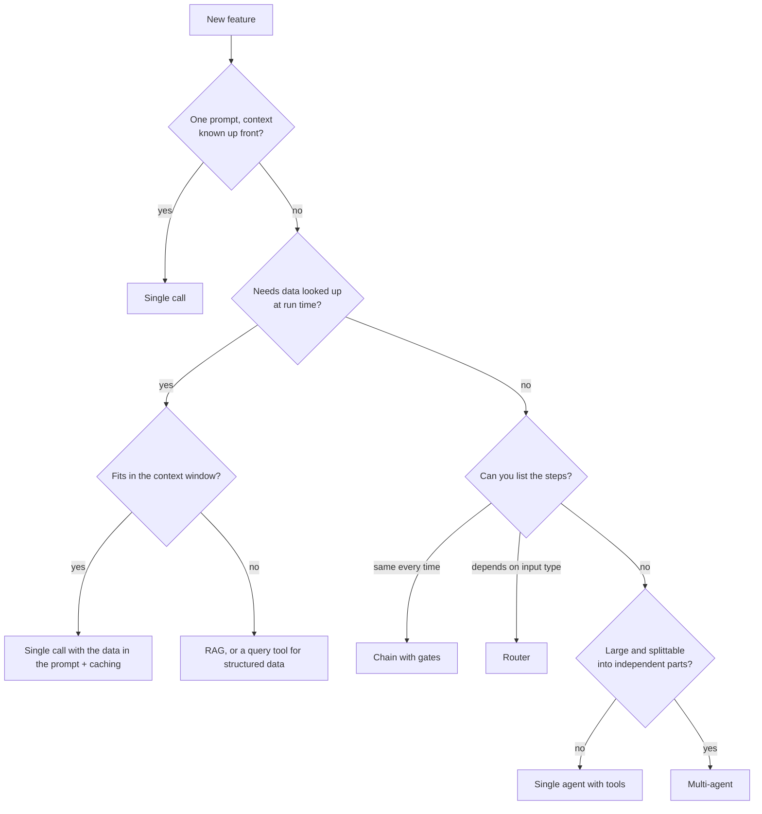
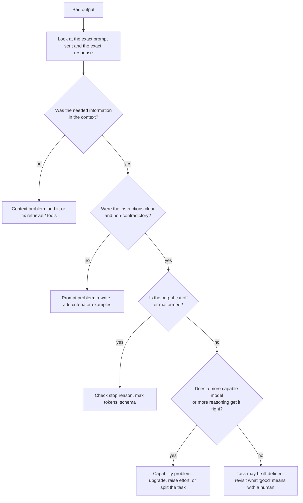

# Appendix A: Cheat sheets

One-page references. Print them, pin them, argue with them.

## 1. Prompt checklist

Before sending, check each line. A failing prompt is nearly always missing one.

- [ ] **Goal.** Does it say what the result is for and who uses it?
- [ ] **Task.** Is the single thing to do stated plainly?
- [ ] **Context.** Is every document, schema, error or fact the answer depends on included?
- [ ] **Constraints.** Stated as what to do, with a reason for anything non-obvious?
- [ ] **Examples.** Several, varied, with the common thread named? (Or deliberately none.)
- [ ] **Format.** Is the output shape specified for its destination?
- [ ] **Escape hatch.** Can the model say "not found" or "unclear" instead of guessing?
- [ ] **Scope.** What is out of bounds? What needs a human?
- [ ] **Colleague test.** Could a smart contractor with no context do this from the prompt alone?
- [ ] **Tested** on at least five varied inputs, not one?

## 2. Bad-to-good rewrite moves

| Symptom in the output | Likely missing | Fix |
|---|---|---|
| Generic, could apply to anyone | Goal, audience | Say who it is for and why |
| Invented facts | Context, escape hatch | Supply the source; allow "not stated" |
| Wrong format, varies between runs | Format | Schema or explicit structure |
| Copies your example | Examples | Add varied examples; name the pattern |
| Too long | Constraints | Give a length and the reason |
| Does too much | Scope | State what not to touch |
| Agrees with everything | Neutral framing | Ask for alternatives and counter-arguments |
| Misses the important bit | Criteria | Say what matters most, in order |
| Reasoning errors | Room to think | Ask for working first, or use a reasoning mode |
| Good once, bad next time | Testing | Run on more inputs; tighten the ambiguous part |

## 3. Architecture decision tree



Rule: take the first branch that works. Justify every step further down.

## 4. Debugging flowchart



Always start by reading the actual prompt and response. Most bugs are visible there.

## 5. Tool design checklist

- [ ] Name says what it does (`search_help_articles`, not `search`)
- [ ] Description covers: what, when to use, when not to, what it returns, input tips
- [ ] Parameters typed, with enums where possible, each described
- [ ] Returns compact, relevant data with readable names
- [ ] Pagination or filters for large results
- [ ] Errors say what was wrong and how to fix the call
- [ ] Read tools separated from write tools
- [ ] Authorization enforced in code with the real user's identity
- [ ] Irreversible actions gated by approval
- [ ] No overlap with another tool

## 6. Agent brief template

```text
Goal:        <what and why, one or two sentences>
Start from:  <files, errors, links, what is already known or ruled out>
In scope:    <what may be changed>
Out of scope:<what must not be touched, and why>
Method:      <reproduce first / plan before editing / one hypothesis at a time>
Done when:   <the command or check that proves it>
Stop if:     <stuck after N attempts; anything irreversible; scope turns out larger>
Report back: <what changed, how it was verified, what is uncertain>
```

## 7. Eval starter

```text
1. Collect 20-50 real inputs (typical, edge, past failures, should-decline, adversarial).
2. For each, write what a good output must and must not contain.
3. Run. Read every output.
4. Group failures by cause. Fix the biggest group.
5. Automate: code graders first, model graders for the rest, calibrated against you.
6. Re-run on every prompt, tool or model change. Compare case by case.
7. Add every production failure as a new case.
```

Judge prompt skeleton:

```text
<input>...</input> <output>...</output> <reference>...</reference>
Criterion: <one specific property>
First quote the evidence. Then end with exactly: VERDICT: PASS or VERDICT: FAIL
```

## 8. Cost and latency levers

| Goal | Levers, biggest first |
|---|---|
| Lower cost | Cache stable prefixes · smaller model for easy cases · less input · less output · batch · skip the call |
| Lower latency | Stream · less output · parallelize · smaller model · fewer sequential calls · lower reasoning effort |
| Higher reliability | Timeouts · capped retries with backoff · fallback model · validation · idempotency · pinned versions |

Cache rule: stable content first, variable content last, prefix byte-identical.

## 9. Security quick review

1. What untrusted text reaches the model?
2. What private data can it see?
3. What can it do or send out?
4. Worst case if the model's output were attacker-controlled?
5. Which control, enforced in code, prevents that?
6. How would you notice?

Never: secrets in prompts · model-supplied user IDs trusted · output into SQL, shell or
HTML unescaped · shared cache across tenants · unreviewed tools with broad access.

## 10. Code review of agent work

- [ ] Ran the check myself
- [ ] Tests not weakened, skipped or special-cased
- [ ] Diff limited to the task
- [ ] No unrequested abstractions or options
- [ ] Unfamiliar APIs and packages verified to exist
- [ ] Errors not swallowed
- [ ] Follows existing conventions
- [ ] No secrets, no string-built queries, authorization intact
- [ ] I understand every line I am merging

---
Previous: [14. Projects](14-projects.md) · Next: [Appendix B: Glossary](appendix-b-glossary.md)
